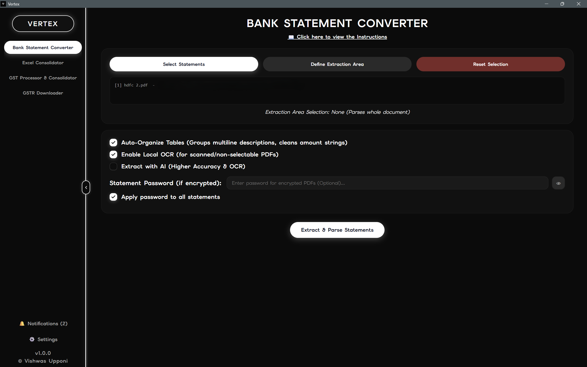
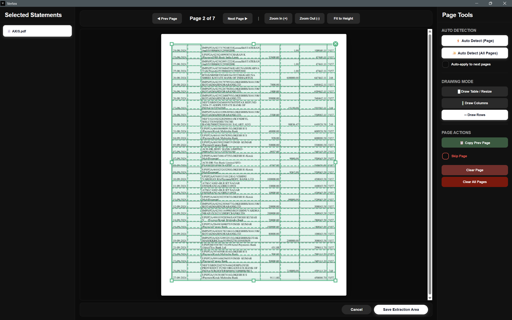
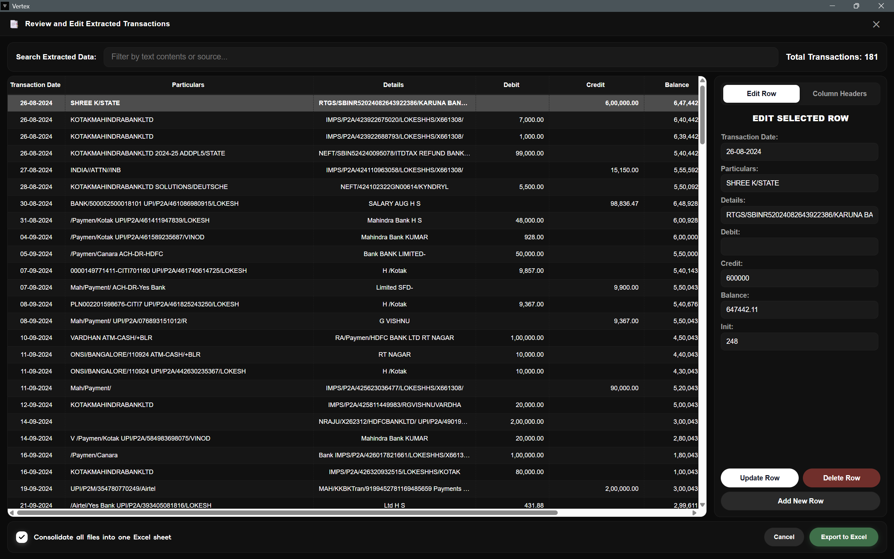
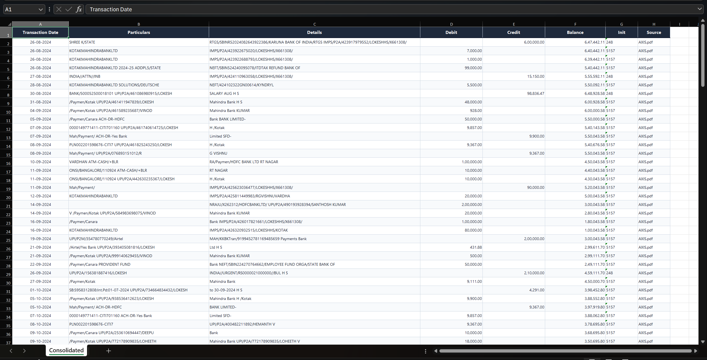

# Bank Statement Converter

Bank Statement Converter is an official addon module for the **Vertex Application**. It parses digital and scanned bank statement PDFs, extracting structured transactions into standardized Excel workbooks ready for immediate financial reconciliation. With built-in support for password-protected statements and an interactive table bounding-box selector, it handles diverse banking formats with precision and privacy.

> [!NOTE]
> **Internet Usage**: Standard document parsing and local table extraction run 100% offline. An internet connection is used only when processing statements with the "Extract with AI" feature.

---

## 📸 Screenshots

### Converter Interface

### Interactive Table Area Selector

### Table Preview & Tuning

### Extraction Output

---

## ✨ Key Features

- **📑 Multi-Statement Batch Processing**: Queue and convert multiple bank statements simultaneously across various banking layouts.
- **🔐 Protected PDF Decryption**: Decrypts password-protected PDF statements using credentials held exclusively in volatile memory.
- **🎯 In-DOM Interactive Table Area Selector**: Visual bounding-box canvas tool embedded directly in the UI for selecting custom transaction boundaries on complex statements.
- **📊 Standardized Column Formatting**: Automatically normalizes transaction dates, descriptions, cheque/ref numbers, debit/credit values, and rolling balances.
- **🤖 Optional AI-Powered Extraction**: Includes an optional AI extraction mode (activated strictly when you explicitly choose it) to accurately extract complex or irregular scanned PDF bank statements that cannot be parsed locally by standard rules.

---

## 📥 Installation

### Via Vertex Module Manager (Recommended)
1. Open the **Vertex Application**.
2. Go to **Settings** in the sidebar and then **Module Manager**.
3. Switch to the **Cloud Store** tab, locate **Bank Statement Converter**, and click **Install**.
4. The addon will automatically download, install, and appear in your active sidebar navigation.

### Manual Package Installation
1. Download the latest release `.vtx` package from the [Releases](https://github.com/vishwasupponi/vtx-bank-statement-converter/releases) page.
2. In Vertex Module Manager, click **"Install Local File"** and choose the downloaded package.

---

## 🚀 Getting Started

1. **Open Tool**: Select **Bank Statement Converter** from the sidebar navigation.
2. **Select Statements**: Click **"Select Statements"** to choose digital or scanned bank statement PDFs (provide statement password if encrypted).
3. **Convert & Export**: Adjust extraction boundaries using the visual **Area Selector** if required, then click **"Convert Statements"** to generate standardized Excel workbooks.

> For more information, check the **Instructions** manual inside Vertex.

---

## 🤝 Contributing & Security

- You are free to develop custom plugins for personal use. To propose a module for the official Cloud Store catalog or submit contributions, see [CONTRIBUTING.md](CONTRIBUTING.md).
- To report a security concern or review the security policy, see [SECURITY.md](SECURITY.md).

---

## 🙏 Acknowledgments

This module is built using various open-source libraries and components under their respective open-source licenses. Building this module would not have been possible without these foundational open-source technologies, and I thank all the original developers and maintainers of these projects for their contributions:

- **[PyMuPDF (fitz)](https://pymupdf.readthedocs.io/)** – High-performance PDF parsing, text extraction, and page rasterization.
- **[pdfplumber](https://github.com/jsvine/pdfplumber/)** – Precision PDF table structure and visual bounding-box extraction.
- **[pandas](https://pandas.pydata.org/)** – Financial tabular data processing, column alignment, and cleaning.
- **[openpyxl](https://openpyxl.readthedocs.io/)** – Excel workbook generation, cell styling, and spreadsheet export.
- **[Pillow (PIL)](https://python-pillow.org/)** – Image processing and statement preview rendering.
- **[NumPy](https://numpy.org/)** – Vectorized coordinate calculations for table bounding boxes.

---

## 📄 License

This project is licensed under the [GNU Affero General Public License v3 (AGPL-3.0)](LICENSE).

Developed by [Vishwas Upponi](https://vishwasupponi.blogspot.com/links).
